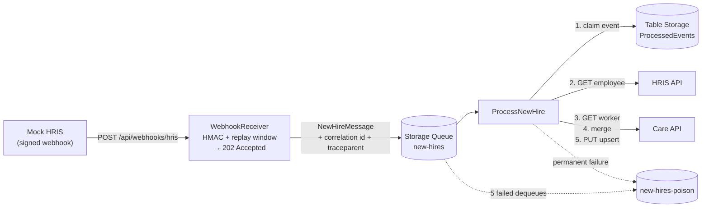
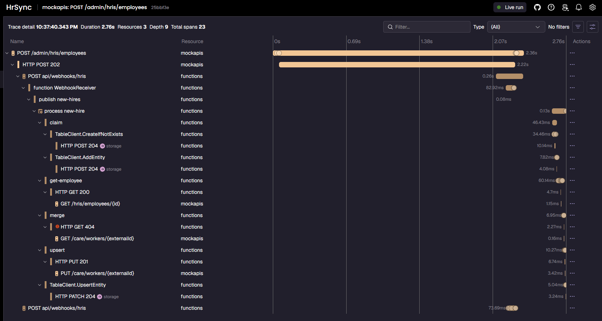
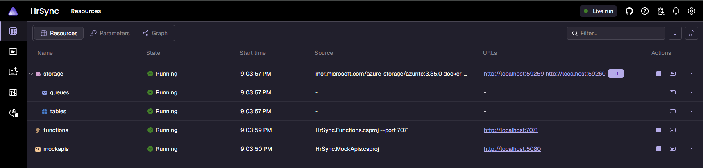

# hris-sync-azure

[](https://github.com/TobiasRafael/hris-sync-azure/actions/workflows/ci.yml)
[](https://dotnet.microsoft.com/)
[](LICENSE)

A webhook-driven **template** for syncing new hires from an HR system into a downstream platform on Azure Functions,
with fast acknowledgment, no duplicates, automatic retries and full traceability.

## Why this exists

HR → downstream integrations tend to fail quietly. A webhook times out and the sender gives up. A vendor resend creates
a second record. A sparse HR record overwrites the phone number someone typed into the target system. When something
does break, nobody can tell which request caused it. This repo is a small, tested reference for doing that sync
properly, built so you can swap in your real HRIS and target system.

All systems here are simulated: the "HRIS" and the "care platform" are local mock APIs, and all data is fictional.

## Architecture



The receiver only verifies, parses and enqueues. The processor fetches the full record, maps it via config, merges it
with the existing worker and upserts it. Vendor calls go through Refit clients with a resilience pipeline. With the
Aspire AppHost running, one distributed trace covers the whole path:



## Reliability guarantees

| Guarantee | How | Where |
|---|---|---|
| Only signed, fresh webhooks are accepted | HMAC-SHA256 over `"{timestamp}.{body}"`, constant-time compare, ±5 min replay window; the signature is checked before the body is parsed | [`WebhookSignature`](src/HrSync.Core/Security/WebhookSignature.cs), [`WebhookReceiver`](HrSync.Functions/Webhooks/WebhookReceiver.cs) |
| Fast acknowledgment | The receiver makes no outbound calls: 401 / 400 / 204 or **202 + enqueue** | [`WebhookReceiver`](HrSync.Functions/Webhooks/WebhookReceiver.cs), [`WebhookReceiverOutput`](HrSync.Functions/Webhooks/WebhookReceiverOutput.cs) |
| No duplicates | Per-event claim in Table Storage (insert, ETag-checked takeover of stale/failed claims, release on transient failure), plus a full-replace upsert keyed by `ExternalId` | [`TableIdempotencyStore`](HrSync.Functions/Idempotency/TableIdempotencyStore.cs), [`NewHireProcessor`](src/HrSync.Core/Processing/NewHireProcessor.cs) |
| Automatic retries | In process: 3 retries with exponential backoff and jitter, `Retry-After` honoured, 10 s per attempt / 30 s total. Then the queue: 5 dequeues, 30 s visibility timeout | [`AddHrSyncAdapters`](src/HrSync.Adapters/DependencyInjection/AdaptersServiceCollectionExtensions.cs), [`host.json`](HrSync.Functions/host.json) |
| Bad data isn't retried forever | 4xx (except 408/429) and "employee not found" are **permanent**: a poison envelope with the reason, event marked `Failed`. 5xx/408/429/timeouts are **transient**: retried | [`VendorErrors`](src/HrSync.Adapters/Http/VendorErrors.cs), [`ProcessNewHire`](HrSync.Functions/NewHires/ProcessNewHire.cs) |
| Existing data is never wiped | GET + merge + PUT: null or blank incoming values never overwrite | [`CareWorkerMerge`](src/HrSync.Core/Rules/CareWorkerMerge.cs) |
| Every request is traceable | `X-Correlation-Id` echoed or generated, carried in the message and sent to vendors; the W3C trace continues across the queue; spans for claim / get-employee / merge / upsert | [`CorrelationIdHandler`](src/HrSync.Adapters/Correlation/CorrelationIdHandler.cs), [`HrSyncTelemetry`](src/HrSync.Core/Diagnostics/HrSyncTelemetry.cs) |
| Misconfiguration fails at startup | Webhook secret, vendor base URLs and field mapping are validated when the host starts | [`Program.cs`](HrSync.Functions/Program.cs), [`FieldMappingValidator`](HrSync.Functions/NewHires/FieldMappingValidator.cs) |

"No duplicates" means no duplicate *records*, not exactly-once execution. A crash between the upsert and marking the
event complete leads to a second, harmless upsert. See [decision 3](docs/decisions.md#3-idempotency-with-a-table-storage-claim-and-etags).

## Quickstart

**Prerequisites:** [.NET 10 SDK](https://dotnet.microsoft.com/download) (pinned in [`global.json`](global.json)), Docker,
[Azure Functions Core Tools v4](https://learn.microsoft.com/azure/azure-functions/functions-run-local), and Visual Studio 2026 or the `dotnet` CLI.

### Option A: Aspire AppHost (recommended)

```bash
# once: the HMAC secret shared by the mock HRIS (signs) and the receiver (verifies). Any dev-only value works.
dotnet user-secrets set "Parameters:webhook-secret" "dev-only-webhook-secret" --project src/HrSync.AppHost

dotnet run --project src/HrSync.AppHost
```

This starts Azurite (container), the mock APIs on `http://localhost:5080`, the Functions host on `http://localhost:7071`,
and the Aspire dashboard on `http://localhost:15180` (the login link is printed in the console).



### Option B: standalone

1. Start Azurite (Visual Studio starts it automatically, or run `npx azurite`).
2. `cp HrSync.Functions/local.settings.example.json HrSync.Functions/local.settings.json`, then set `Webhook__Secret` to the
   value of `Webhook:Secret` in [`src/HrSync.MockApis/appsettings.Development.json`](src/HrSync.MockApis/appsettings.Development.json).
3. Run both:
   ```bash
   dotnet run --project src/HrSync.MockApis --launch-profile http   # :5080
   cd HrSync.Functions && func start --port 7071
   ```

There is no Aspire dashboard in this mode.

## Try it

Open [`requests.http`](requests.http) in Visual Studio, Rider or VS Code (REST Client) and run the **Step 4** block in order.
After each trigger, give the queue a few seconds, then check `GET /admin/requests` (the mock's request log, where injected
faults are marked `(injected)`) and the trace in the dashboard.

| Scenario | What happens | What to look for |
|---|---|---|
| **Happy path** (4.1) | Create employee E-3001 → signed webhook → 202 → queue → worker created | `PUT /care/workers/E-3001 -> 201`; one trace from `POST /admin/hris/employees` to the PUT |
| **Resend** (4.2) | Same `event_id` sent again | Receiver still answers 202, but there is **no** new HRIS GET or PUT; the processor logs `Skipped` |
| **3 × 503** (4.3) | Next 3 care requests fail with `Retry-After: 1` | Three `503 (injected)` lines, then 2xx in the same invocation |
| **429 + Retry-After** (4.4) | Next 2 HRIS requests fail with `Retry-After: 2` | Two `429 (injected)`, then 200 after about 4 s of waiting |
| **Sparse update** (4.5) | Bob already has a phone and email in care; his HRIS record has neither | `GET /care/workers/E-1002` keeps the phone and email; the role is updated |
| **400 → poison** (4.6) | Empty last name; the care API rejects it | `PUT ... -> 400` once (no retries); envelope with the reason in `new-hires-poison`; event `Failed` in `ProcessedEvents` |
| **Long outage** (4.7) | Care fails 50 times | 4 attempts per dequeue × 5 dequeues, then the raw message lands in `new-hires-poison` (takes a few minutes) |

<!-- TODO: add docs/images/demo.gif (see docs/images/README.md) and embed it here. -->

## Testing strategy

| Layer | Project | Tests | What it covers |
|---|---|---:|---|
| Core unit | `tests/HrSync.Core.Tests` | 61 | Signature, field mapper validation, merge rule, processor flow and failure paths, telemetry spans |
| Adapters | `tests/HrSync.Adapters.Tests` | 67 | Webhook parsing, error classification, DI wiring; 7 of them drive the **real resilience pipeline over HTTP against WireMock** (503/429/Retry-After/timeouts) |
| Functions | `tests/HrSync.Functions.Tests` | 37 | Receiver and queue trigger called directly; 7 are **integration tests against real Azurite** (Testcontainers) for the idempotency store's ETag paths |
| E2E | `tests/HrSync.AppHost.Tests` | 1 | Starts the whole AppHost with Aspire.Hosting.Testing: create employee → worker appears in the care API |

```bash
dotnet test HrSync.slnx                                   # everything (integration/E2E skip themselves without Docker/func)
dotnet test HrSync.slnx -c Release --filter "Category!=E2E"   # what CI runs: 165 tests
dotnet test HrSync.slnx --filter "Category=Integration"       # Azurite via Testcontainers, or HRSYNC_TEST_AZURITE=UseDevelopmentStorage=true
dotnet test HrSync.slnx --filter "Category=E2E"               # local only: needs Docker + Azure Functions Core Tools
```

[CI](.github/workflows/ci.yml) builds in Release on `ubuntu-latest` and runs everything except E2E, including the
Testcontainers integration tests. It uploads TRX and Cobertura coverage and writes a pass/fail summary. Its first run on
Linux caught a real bug: there, `Uri.TryCreate("/relative/path", UriKind.Absolute)` succeeds (as `file:///relative/path`),
so base-URL validation accepted a relative path that Windows rejected. The fix now requires an http(s) scheme.

## Configuration

Functions settings (environment variables, or `local.settings.json` locally):

| Setting | Purpose | Example |
|---|---|---|
| `Webhook__Secret` | HMAC key for incoming webhooks (**required**) | dev-only value; injected by the AppHost |
| `HrisApi__BaseUrl` | HRIS API base URL (**absolute http(s)**) | `http://localhost:5080` / `http://mockapis` |
| `CareApi__BaseUrl` | Care API base URL (**absolute http(s)**) | `http://localhost:5080` / `http://mockapis` |
| `AzureWebJobsStorage` | Functions host storage | `UseDevelopmentStorage=true` |
| `queues` | Connection for the queue trigger and output | `UseDevelopmentStorage=true` |
| `Aspire__Azure__Storage__Queues__queues__ConnectionString` | Queue client (poison writes) | `UseDevelopmentStorage=true` |
| `Aspire__Azure__Data__Tables__tables__ConnectionString` | Table client (idempotency) | `UseDevelopmentStorage=true` |
| `FieldMapping__Fields__<Target>` | Which `Employee` property feeds each `CareWorker` property | `FieldMapping__Fields__Phone=MobilePhone` |
| `OTEL_EXPORTER_OTLP_ENDPOINT` | OTLP export; nothing is exported when unset | set by the AppHost |

Under the AppHost, the storage, URL and secret settings are injected and override `local.settings.json`.
In `local.settings.json`, use the same keys as above rather than `ConnectionStrings__queues`: that key takes precedence and would point
everything at your local Azurite instead of the AppHost's emulator.

**Field mapping** is config only: target `CareWorker` property → source `Employee` property. The defaults live in
[`HrSync.Functions/appsettings.json`](HrSync.Functions/appsettings.json):

```json
"FieldMapping": {
  "Fields": {
    "GivenName": "FirstName",
    "FamilyName": "LastName",
    "Email": "WorkEmail",
    "Phone": "MobilePhone",
    "Role": "JobTitle",
    "StartDate": "HireDate"
  }
}
```

To feed `Email` from the personal address instead, set `FieldMapping__Fields__Email=PersonalEmail`. No code change is needed.

**Fails at startup:** a missing `Webhook__Secret`, a base URL that isn't absolute http(s), and a field mapping that is
empty, names an unknown property, mismatches types, or tries to map `ExternalId` (always `Employee.Id`, the upsert key).

## Adapting it to your systems

1. **Source (HRIS):** in `src/HrSync.Adapters`, add a Refit interface for its API, a DTO, and a Mapperly mapper to `Employee`.
   Then implement [`IHrisClient`](src/HrSync.Core/Ports/IHrisClient.cs), returning `null` for not-found and classifying errors
   with `VendorErrors` (see [`HrisHttpClient`](src/HrSync.Adapters/Hris/HrisHttpClient.cs)).
2. **Webhook:** adapt [`HrisWebhookParser`](src/HrSync.Adapters/Hris/HrisWebhookParser.cs) to the vendor's payload, and
   [`WebhookSignature`](src/HrSync.Core/Security/WebhookSignature.cs) if they sign differently.
3. **Target:** implement [`ICareClient`](src/HrSync.Core/Ports/ICareClient.cs) the same way (GET by external id, full-replace upsert).
4. **Register** the clients in [`AddHrSyncAdapters`](src/HrSync.Adapters/DependencyInjection/AdaptersServiceCollectionExtensions.cs)
   and set `HrisApi__BaseUrl` / `CareApi__BaseUrl`.
5. **Fields:** add any new properties to `Employee` / `CareWorker` (the merge picks them up automatically), then map them in `FieldMapping`.
6. **Mock it:** mirror the vendor's endpoints in `src/HrSync.MockApis` so `requests.http` and the E2E test keep working.

## Project structure

```text
HrSync.Functions/          Azure Functions host (isolated worker): WebhookReceiver, ProcessNewHire, idempotency store, poison queue
src/
  HrSync.Core/             Models, ports, processor, merge rule, field mapper, webhook signature, telemetry. No dependencies.
  HrSync.Adapters/         Refit clients, Mapperly mappers, error classification, resilience, correlation id handler
  HrSync.MockApis/         Fake HRIS + care API with fault injection and a signed-webhook sender (no Core reference)
  HrSync.AppHost/          Aspire orchestration: Azurite, mocks, Functions, secret parameter
  HrSync.ServiceDefaults/  OpenTelemetry, health checks, service discovery, HttpClient resilience
tests/                     Core, Adapters, Functions (incl. Testcontainers) and AppHost E2E test projects
docs/                      Design decisions and images
requests.http              Manual end-to-end scenarios
.github/                   CI workflow, Dependabot, test summary script
```

`HrSync.Functions` lives at the repo root, not under `src/`. It still contains the unused `Function1.cs` from the project template.

## Design decisions

Short ADRs with context and trade-offs are in [docs/decisions.md](docs/decisions.md):

- [Thin webhook, then fetch the full record](docs/decisions.md#1-thin-webhook-then-fetch-the-full-record) so resends and out-of-order events can't sync stale data
- [A queue between receiver and processor](docs/decisions.md#2-a-queue-between-the-receiver-and-the-processor) for a fast ack that is independent of the target system's health
- [Table Storage claim with ETags](docs/decisions.md#3-idempotency-with-a-table-storage-claim-and-etags) instead of distributed locks
- [Two levels of retries](docs/decisions.md#4-two-levels-of-retries) (in process, then queue) without retry multiplication
- [Permanent vs transient classification](docs/decisions.md#5-permanent-vs-transient-failures), so bad data goes to poison in seconds
- [GET + merge + PUT, never overwrite with empty values](docs/decisions.md#6-get--merge--put-never-overwrite-with-empty-values)
- [Config-driven field mapping vs compile-time DTO mapping](docs/decisions.md#7-runtime-field-mapping-from-config-compile-time-dto-mapping),
  plus [mocks without Core](docs/decisions.md#8-the-mocks-dont-reference-core), [Aspire + OpenTelemetry](docs/decisions.md#9-aspire-and-opentelemetry-instead-of-direct-application-insights)
  and [library choices](docs/decisions.md#10-library-choices)

## Scope and limitations

This is a template and reference implementation, not a deployed product:

- Only `employee.hired` is handled; other event types are acknowledged with 204 and ignored. There are no updates-after-hire, terminations or deletes.
- Secrets come from configuration (user-secrets locally); there is no Key Vault or Managed Identity yet.
- There is no infrastructure-as-code or deployment pipeline yet, and no Azure Monitor exporter in the cloud.
- Poison messages are inspected and replayed by hand.

## Roadmap

Planned, **not implemented**:

- [ ] Bicep IaC for the Function App, storage and monitoring
- [ ] Managed Identity for storage, and Key Vault for the webhook secret
- [ ] Azure Service Bus with a dead-letter queue as an alternative to Storage Queues
- [ ] Deployment workflow (GitHub Actions → Azure, OIDC)
- [ ] Azure Document Intake agent (planned as a separate repo)

## License

[MIT](LICENSE)

## About

Built by **Rafael Genao**, an Azure integration engineer (C#/.NET, Azure Functions, Data Factory), available for integration work.
<!-- TODO: Upwork URL -->
